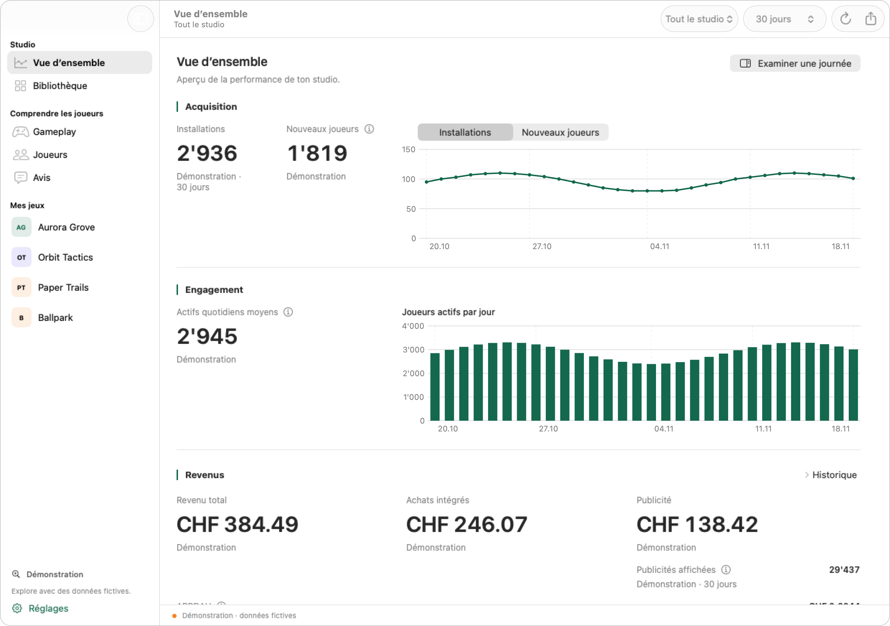
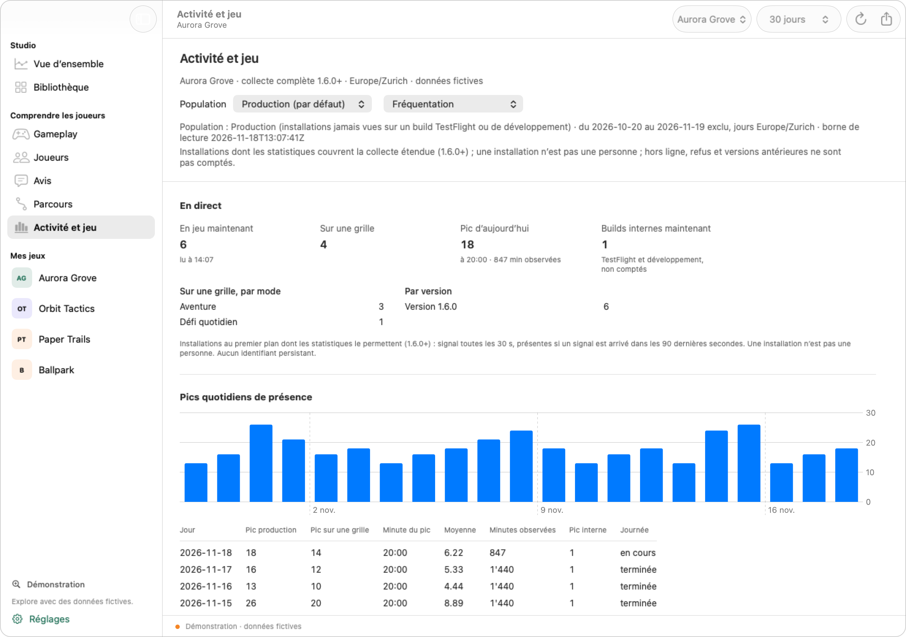
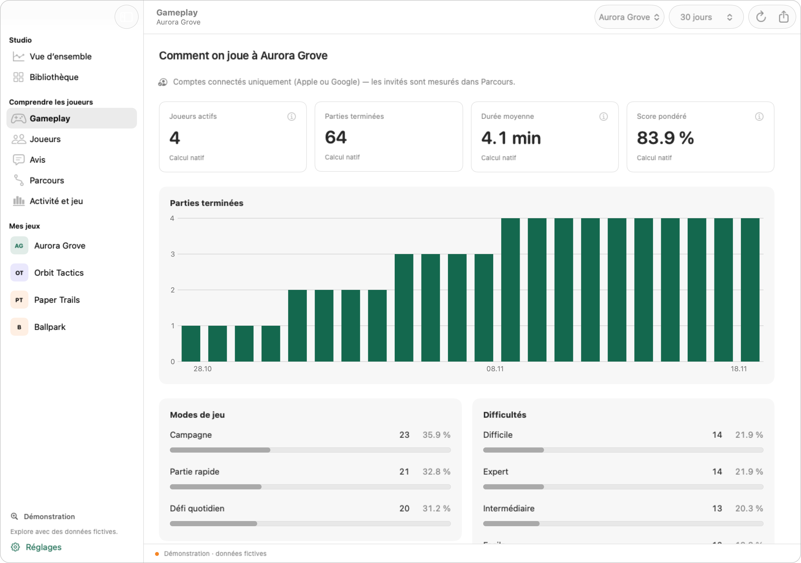

# GameMetrik

*[English version](README.md)*

<picture>
  <source media="(prefers-color-scheme: dark)" srcset="docs/screenshots/overview-dark.png">
  
</picture>

App macOS native, avec un compagnon iPhone, qui rassemble les chiffres d'un petit studio de jeux : ventes des boutiques,
revenus publicitaires, **installations**, **joueurs actifs**, gameplay et rétention. Elle lit chaque fournisseur
directement depuis ton Mac et affiche, près de chaque chiffre, d'où il vient et ce qu'il couvre.

Sources : **App Store Connect**, **Google Play**, **AdMob**, **Firebase/Firestore** et **Supabase**.

Elle a été écrite par un développeur indépendant pour ses propres jeux, puis ouverte. Ses deux jeux figurent ici sous
des noms d'emprunt, Aurora Grove et Ballpark.

## Principes

- **Tout en local.** Ni serveur, ni compte à créer, ni télémétrie. Le seul trafic réseau va vers les fournisseurs que tu connectes.
- **Honnête.** Une source en échec est indiquée comme indisponible, jamais comme zéro. Les devises ne sont jamais additionnées.
- **Verrouillée par défaut.** Les identifiants restent dans le trousseau, derrière Touch ID ou ton mot de passe. L'app
  démarre verrouillée, et se verrouille à la veille, au verrouillage de l'écran et après cinq minutes sans activité.
- **Native.** SwiftUI, AppKit et Swift Charts. Aucune dépendance hors des SDK Apple : ni Node, ni vue web, ni serveur local.
- **Rien de brut sur le disque.** Les parties et les profils des joueurs restent en mémoire. Le cache ne contient que
  des agrégats, chiffrés en AES-256-GCM.
- **Interface en français**, comme les guides détaillés. Les commentaires du code sont en anglais.

## Fonctions

- Vue d'ensemble du studio : installations, nouveaux joueurs, joueurs actifs par jour, revenus par devise et par source
- Pages par jeu : acquisition, gameplay, joueurs, avis, parcours des joueurs, monétisation, activité en direct
- Inspecteur de journée : une journée à travers toutes les sources
- Couverture près des chiffres : population, période, fuseau horaire, ce qui n'est pas collecté
- Synchronisation manuelle avec un cache chiffré : une journée définitive n'est pas relue
- Export CSV et JSON des tableaux complets
- Dossier facultatif de tableaux agrégés pour un assistant IA, qui peut aussi demander une synchronisation
- Mode démonstration avec des données fictives, séparé de l'espace réel
- Compagnon iPhone qui partage le même module, connecté par un fichier de transfert chiffré et de courte durée

## Captures d'écran

<p align="center">
  <picture>
    <source media="(prefers-color-scheme: dark)" srcset="docs/screenshots/insights-dark.png">
    
  </picture>
</p>

<p align="center">
  <picture>
    <source media="(prefers-color-scheme: dark)" srcset="docs/screenshots/gameplay-dark.png">
    
  </picture>
</p>

<p align="center"><sub>Rendu à partir des vues de l'app, avec des données de démonstration.</sub></p>

## Prérequis

macOS 14 ou ultérieur, et Xcode 16 ou ultérieur (Swift 6) pour compiler. L'app iPhone demande iOS 17 ou ultérieur.

Il n'y a pas encore de version à télécharger : GameMetrik se compile depuis les sources.

## Essayer la démonstration

Sans compte développeur Apple.

```sh
git clone https://github.com/Axxxxpirine/GameMetrik.git
cd GameMetrik
GAMEMETRIK_DEMO_BUILD=1 ./NativeApp/scripts/build.sh
open "NativeApp/dist/GameMetrik Demo.app"
```

Clique **Déverrouiller** et confirme avec Touch ID ou le mot de passe du Mac. L'app s'ouvre sur les données de démonstration.

Le paquet de démonstration est signé ad hoc, pour ton Mac uniquement. Il n'a pas de groupe de trousseau et ne peut donc
enregistrer aucune connexion : il affiche des données fictives, rien d'autre.

## Compiler

```sh
swift test --package-path NativeApp                  # tests : fixtures synthétiques, aucun réseau
GAMEMETRIK_DEMO_BUILD=1 ./NativeApp/scripts/build.sh # NativeApp/dist/GameMetrik Demo.app, signature ad hoc
./NativeApp/scripts/build.sh                         # NativeApp/dist/GameMetrik Native.app, ton identité et ton profil Apple
./NativeApp/scripts/notarize.sh PROFIL               # notarisation d'un paquet Developer ID
./iOSApp/scripts/build.sh                            # app iPhone pour le simulateur (demande XcodeGen)
```

Les connexions réelles sont rangées dans le trousseau Data Protection, dans un groupe que macOS n'accorde qu'à une app
signée avec un profil de provisionnement. Le paquet complet demande donc une adhésion Apple Developer, un identifiant
d'app `ch.gamemetrik.native` dans ton équipe (ou le tien, remplacé partout dans les sources) avec un profil macOS qui
inclut son groupe de trousseau, et l'identité de signature dans ton trousseau. Le script les trouve seul ;
`GAMEMETRIK_SIGNING_IDENTITY` et `GAMEMETRIK_SIGNING_PROFILE` permettent de les choisir. Il ne revient jamais à une
signature ad hoc, sauf si tu demandes le paquet de démonstration.

Connecte ensuite tes fournisseurs : [NativeApp/CONNEXION.md](NativeApp/CONNEXION.md).

## Limites connues

- Les parties génériques fonctionnent pour tout studio : App Store Connect, Google Play, AdMob et un catalogue de jeux dans Firestore.
- Les rapports de parcours, de monétisation, d'activité en direct et de Ballpark appellent des fonctions d'analyse qui
  n'existent que dans les projets Supabase de l'auteur. Ailleurs, ce sont des exemples complets d'un contrat de rapport,
  de sa validation et de son affichage.
- L'interface n'existe qu'en français.
- Les clés que tu importes gardent leurs droits chez le fournisseur. L'app ne fait que lire, mais elle ne transforme pas
  une clé d'administration en clé de lecture seule.

## Organisation

| Chemin | Contenu |
| --- | --- |
| `NativeApp/Sources/GameMetrikCore` | Modèles, clients des fournisseurs, contrats de rapports, agrégation, exports. Aucune interface. |
| `NativeApp/Sources/GameMetrikNative` | L'app macOS : vues SwiftUI, état de l'app, coffre du trousseau. |
| `NativeApp/Tests` | Tests unitaires et d'intégration sur fixtures synthétiques. |
| `NativeApp/scripts` | Scripts de compilation, de paquet et de notarisation. |
| `iOSApp` | Le client iPhone. Voir [iOSApp/README.md](iOSApp/README.md). |

Détail de la sécurité : [NativeApp/SECURITE.md](NativeApp/SECURITE.md). Pour signaler une faille, voir
[SECURITY.md](SECURITY.md). Pour contribuer, voir [CONTRIBUTING.md](CONTRIBUTING.md).

## Licence

[MIT](LICENSE). GameMetrik est un projet indépendant, sans lien avec Apple, Google, Firebase, AdMob ou Supabase.
