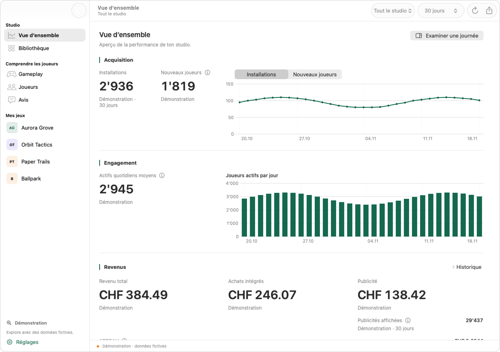
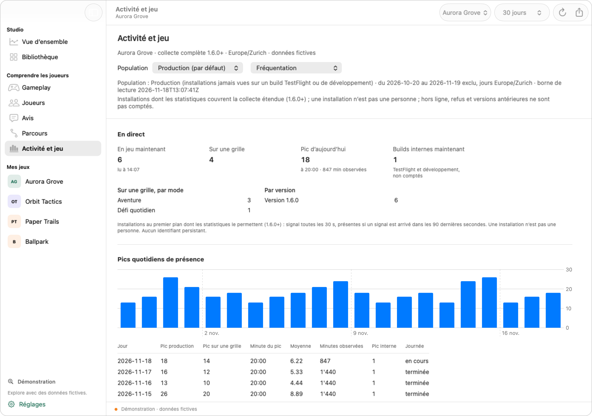
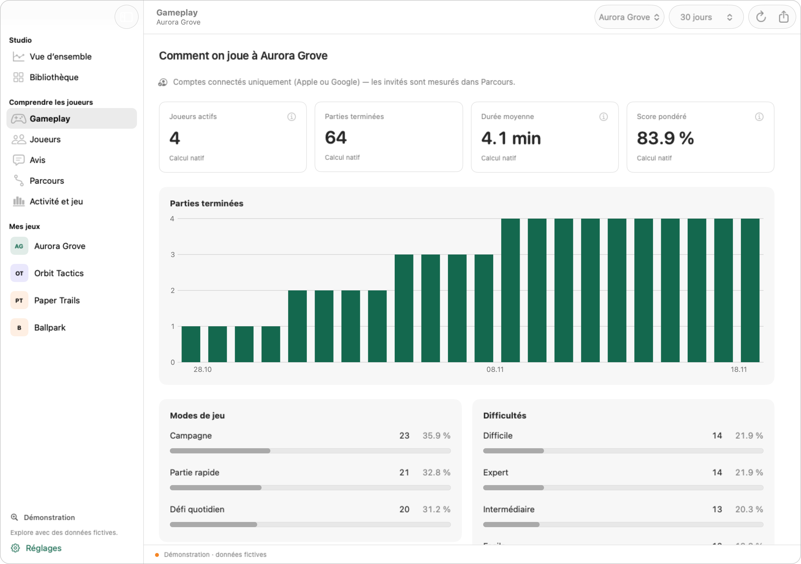

# GameMetrik

*[Version française](README.fr.md)*

<picture>
  <source media="(prefers-color-scheme: dark)" srcset="docs/screenshots/overview-dark.png">
  
</picture>

A native macOS app, with an iPhone companion, that brings a small game studio's numbers into one place: store sales,
ad revenue, **installs**, **active players**, gameplay and retention. It reads each provider directly from your Mac and
shows, next to every figure, where it comes from and what it covers.

Sources: **App Store Connect**, **Google Play**, **AdMob**, **Firebase/Firestore** and **Supabase**.

It was built by an indie developer for their own games, then opened up. Their two games appear here under placeholder
names, Aurora Grove and Ballpark.

## Principles

- **Local only.** No server, no account to create, no telemetry. The only network traffic goes to the providers you connect.
- **Honest.** A source that failed is shown as unavailable, never as zero. Currencies are never added together.
- **Locked by default.** Credentials live in the keychain behind Touch ID or your password. The app starts locked and
  locks again on sleep, on screen lock and after five minutes without activity.
- **Native.** SwiftUI, AppKit and Swift Charts. No dependency outside the Apple SDKs: no Node, no web view, no local server.
- **Nothing raw on disk.** Game sessions and player profiles stay in memory. The cache holds aggregates only, encrypted
  with AES-256-GCM.
- **French interface.** So are the in-depth guides. This README and the code comments are in English.

## Features

- Studio overview: installs, new players, daily active players, revenue per currency and per source
- Per-game pages: acquisition, gameplay, players, reviews, player journey, monetization, live activity
- Day inspector: one day across every source
- Coverage beside the figures: population, period, time zone, what is not collected
- Manual synchronization with an encrypted cache: a day that is final is not fetched twice
- CSV and JSON export of the full tables
- Optional folder of aggregated tables for an AI assistant, which can also request a synchronization
- Demonstration mode with fictitious data, separate from the real workspace
- iPhone companion sharing the same core module, connected through an encrypted, short-lived transfer file

## Screenshots

<p align="center">
  <picture>
    <source media="(prefers-color-scheme: dark)" srcset="docs/screenshots/insights-dark.png">
    
  </picture>
</p>

<p align="center">
  <picture>
    <source media="(prefers-color-scheme: dark)" srcset="docs/screenshots/gameplay-dark.png">
    
  </picture>
</p>

<p align="center"><sub>Rendered from the app's own views with demo data.</sub></p>

## Requirements

macOS 14 or later, and Xcode 16 or later (Swift 6) to build. The iPhone app needs iOS 17 or later.

There is no downloadable build yet: GameMetrik is built from source.

## Try the demonstration

No Apple developer account needed.

```sh
git clone https://github.com/Axxxxpirine/GameMetrik.git
cd GameMetrik
GAMEMETRIK_DEMO_BUILD=1 ./NativeApp/scripts/build.sh
open "NativeApp/dist/GameMetrik Demo.app"
```

Click **Déverrouiller** and confirm with Touch ID or your Mac password. The app opens on the demonstration data.

The demonstration build is signed ad hoc, for your Mac only. It has no keychain group, so it cannot store connections:
it shows fictitious data and nothing else.

## Build

```sh
swift test --package-path NativeApp                  # tests: synthetic fixtures, no network
GAMEMETRIK_DEMO_BUILD=1 ./NativeApp/scripts/build.sh # NativeApp/dist/GameMetrik Demo.app, ad hoc signature
./NativeApp/scripts/build.sh                         # NativeApp/dist/GameMetrik Native.app, your Apple identity and profile
./NativeApp/scripts/notarize.sh PROFILE              # notarization of a Developer ID build
./iOSApp/scripts/build.sh                            # iPhone app for the simulator (needs XcodeGen)
```

Real connections are stored in the Data Protection keychain, in a group that macOS grants only to an app signed with a
provisioning profile. The full build therefore needs an Apple Developer membership, an App ID `ch.gamemetrik.native` in
your team (or your own identifier, replaced throughout the sources) with a macOS profile that includes its keychain
access group, and the signing identity in your keychain. The script finds them on its own;
`GAMEMETRIK_SIGNING_IDENTITY` and `GAMEMETRIK_SIGNING_PROFILE` pick them explicitly. It never falls back to an ad-hoc
signature unless you ask for the demonstration build.

Then connect your providers: [NativeApp/CONNEXION.md](NativeApp/CONNEXION.md), in French.

## Known limitations

- The generic parts work for any studio: App Store Connect, Google Play, AdMob and a games catalogue in Firestore.
- The journey, monetization, live activity and Ballpark reports call analytics functions that exist only in the author's
  Supabase projects. Elsewhere they are worked examples of a report contract, its validation and its display.
- The interface is in French only.
- The keys you import keep the rights they have at the provider. The app only reads, but it does not make an
  administration key read-only.

## Layout

| Path | Content |
| --- | --- |
| `NativeApp/Sources/GameMetrikCore` | Models, provider clients, report contracts, aggregation, exports. No UI. |
| `NativeApp/Sources/GameMetrikNative` | The macOS app: SwiftUI views, app state, keychain vault. |
| `NativeApp/Tests` | Unit and integration tests with synthetic fixtures. |
| `NativeApp/scripts` | Build, packaging and notarization scripts. |
| `iOSApp` | The iPhone client. See [iOSApp/README.md](iOSApp/README.md), in French. |

Security details: [NativeApp/SECURITE.md](NativeApp/SECURITE.md), in French. To report a vulnerability, see
[SECURITY.md](SECURITY.md). To contribute, see [CONTRIBUTING.md](CONTRIBUTING.md).

## License

[MIT](LICENSE). GameMetrik is an independent project, not affiliated with Apple, Google, Firebase, AdMob or Supabase.
